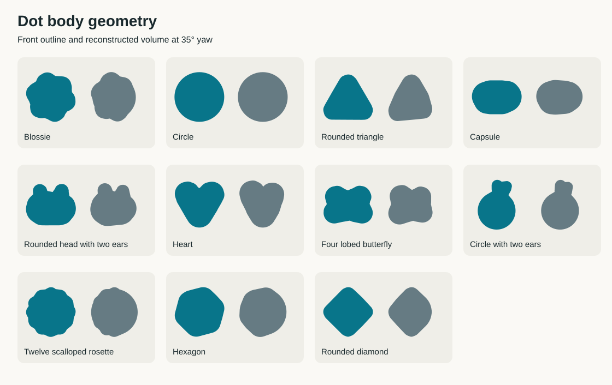

# Dots customization and geometry

The linked character opens as a cyan rounded triangle with sleepy lids, a yellow crown and fur. The signed-in editor displayed eleven body tiles, ten body colours, two finishes, eight selectable eye designs, six eyewear choices including None, and nine extras including None. Body and accessory colours are independent. Observations were made on November 25–26, 2026. [Reference character](https://chatgpt.com/dots/5c7d15af6e7a2420aef2950b1dcac542089e0f756ae39e54921d9f2d4e5782cf~6b07bce089908192b6d9f7043c33109b)

The live renderer also accepted **Six-lobed flower**. Its **Round inset** eye entry was available exclusively on **Rounded head with two ears**, where it was already selected. The editor represents that combination by hiding the Eyes control. The eight starter tiles, the renderer’s 108 catalog entries and the separate pet picker are different collections. [Catalog inventory](dot-catalog.csv)

## Body geometry

The dimensions below are orthographic measurements of the bare solid, before adding fur, eyes or wardrobe. X runs right, Y runs up and Z points toward the viewer. Dimensions use the renderer’s body coordinates. The depth column includes both the front and the back. The picker paths use their own framing.

| Body | Width × height × depth | Geometry |
|---|---:|---|
| Blossie | 2.000 × 2.000 × 1.209 | Unequal petals and an off-centre crown. The front and back have different curvature. |
| Circle | 2.000 × 2.000 × 1.759 | Circular face with a shallower depth axis. The highlight follows the ellipsoid as it turns. |
| Rounded triangle | 2.000 × 1.771 × 1.600 | Short rounded apex, broad base and three convex corners. |
| Capsule | 2.000 × 1.375 × 1.279 | Long horizontal axis with rounded ends and a flattened vertical section. |
| Rounded head with two ears | 2.000 × 1.604 × 1.424 | Wide cheeks and separated upper sockets. The pupils lie on the pale socket surfaces. |
| Heart | 2.000 × 1.833 × 1.603 | Two rounded upper lobes meet in a notch. The flanks taper into a rounded lower point. |
| Four-lobed butterfly | 2.000 × 1.542 × 1.439 | Four wings with recesses on all four sides and wider upper lobes. |
| Circle with two ears | 1.500 × 2.000 × 1.250 | Two projections rise above a smaller round face. The eye line sits below the centre of the full body. |
| Twelve-scalloped rosette | 2.000 × 1.979 × 1.700 | Twelve shallow radial scallops. The valleys remain visible in profile. |
| Hexagon | 1.896 × 2.000 × 1.573 | Rounded six-sided projection with unequal visible faces. The renderer records this as rounded_cube. |
| Rounded diamond | 2.000 × 1.958 × 1.620 | Four rounded diagonal flanks, with broader top and bottom tips. |
| Six-lobed flower | 2.000 × 1.833 × 1.650 | Six rounded lobes. The renderer accepts this body and uses it for catalog characters including Tavi and the flower-bodied Felipe. |

The twelve builder solids use closed meshes fitted to six orthographic depth and normal observations at 768 px. Their six surface patches share vertices along adjacent edges. The frontal silhouette also has an independent 1,024-direction measurement. The fixed portraits use separate front and back sections. For instance, the central front of Alfred is approximately 0.60 units deep, compared with 0.80 on the builder triangle.

The renderer also accepts a continuous depth setting for builder bodies and matte catalog characters. At settings 0, 0.25, 0.5, 0.75 and 1, the measured local Z multipliers were 0.6, 0.8, 1, 1.2 and 1.4. X and Y stayed fixed. Eyes, eyewear and extras followed the same change. The fixed furry portraits retained their recorded depth of 0.5. The live picker had no depth slider. The library exposes this through the optional `depth` field in `dotAvatar`.

These registered views show the bare body in the live studio. Each plate uses the same camera scale. The butterfly has a central crease visible from the side. The rosette’s ridges and the flower’s lobes extend around their depth. The top views show how the two eared bodies carry their projections.

- [Blossie, Circle, Rounded triangle and Capsule](dot-review/geometry-1.png)
- [Rounded head with two ears, Heart, Four-lobed butterfly and Circle with two ears](dot-review/geometry-2.png)
- [Twelve-scalloped rosette, Hexagon, Rounded diamond and Six-lobed flower](dot-review/geometry-3.png)

The diagram below shows the picker outlines in the SVG fallback. The validation report also includes the illuminated WebGL surfaces and rotated views. [Rendered comparisons](dot-parity.md)

## Colour and finish

| Body swatch | sRGB | Body swatch | sRGB |
|---|---|---|---|
| White | #FFFFFF | Cyan | #00B1FF |
| Pink | #FA70AB | Teal | #04BB9F |
| Orchid | #DD6ADC | Lime | #B6D80B |
| Violet | #A25BFF | Yellow | #FFCC38 |
| Blue | #4778FF | Coral | #FF8066 |

The extra palette repeats Pink, Orchid, Violet, Blue, Cyan, Teal, Lime, Yellow, Coral and White, then adds Charcoal (#1F1F1F) and Brown (#8C4A2B). Choosing None removes the colour control. Thelma uses a separate light yellow. The displayed hex value for that preset is an approximation.

**Glossy** shows a broad studio reflection and a smaller bright reflection. Identically oriented normals on two different parts of the body can have different brightness. The position of the surface relative to the lights matters. The independent shader was calibrated from 30,000 position-and-normal samples per body swatch. On the mounted avatar, the body, eye inserts and fittings share the same depth buffer.

**Fur** breaks up the highlight with a short, fine pile. The builder coat is finer than the grain on the named furry portraits. The builder uses seven translucent shells. For each of the twelve bodies, 22 studio orientations measure the height and directional response of the visible grain. The shader samples this raised surface as the viewpoint changes. Separate colour measurements calibrate the response across all ten swatches. The body and its fitted accessories also contribute depth to the soft contact shadows under lids, glasses and headwear. The field follows the solid under yaw, pitch and roll. For each fixed furry portrait, 36 separate orientations measure how small clumps brighten or darken as the head turns. The port projects this raised optical surface onto the body and calculates the shadows its fittings cast. The review report measures the remaining difference in their grain.

## Eyes and glasses

| Eye design | Details visible close up |
|---|---|
| Swept lids | A rounded dark insert with an outer tapered sweep. |
| Oval | Two upright dark inserts with curved fronts. |
| Sparkle capsules | An elongated eye with a four-point white sparkle and a separate small white dot. |
| Highlight capsules | An elongated eye with one round white inset. |
| Dots | Two small dark circular inserts. |
| Round highlights | A larger round eye with an offset catch of light. |
| Crescent inset | A pale outer disc, a dark pupil and an offset pale inset. |
| Sleepy lids | A wide horizontal brow over a shorter vertical pupil. |
| Round inset, fixed | Pale raised sockets and dark pupils on the frog-shaped head. |

The monocle has an open rim and a hanging chain. Tall oval frames have two open rims and retain visible eyes. The separate trapezoid lenses are unbridged. Classic sunglasses have a heavy continuous brow. Round sunglasses have two round lenses and a shaped bridge. The three opaque styles cover the builder eyes. None leaves the selected eyes visible.

The positioning data includes the differences between wearers. For example, the same oval pair sits lower and closer together on Circle with two ears. Printed highlights follow the eye’s curved surface through a blink. The lenses and temples stay with the head. Pointer tracking is specific to the insert. On Highlight capsules the dark supports stay in place while the white catches move. On the frog, the pupils travel across the raised pale sockets.

## Extras

| Extra | Geometry and fit |
|---|---|
| None | Leaves the body and face exposed. |
| Headphones | An arch, separate pads and side pieces. The arch changes shape around the ears. |
| Bow tie | Two lobes meet below the face and follow the lower front of the body. |
| Beanie | A rounded cap over a thick turned-up cuff. The inside of the cuff can occlude the forehead. |
| Hat | A domed upper section and a broad, tilted brim with a visible underside. |
| Beret | An asymmetric, sloping cap, a rim and a raised button. |
| Bulb | A small round fitting above the crown of the head. Thelma’s bulb has a different size and placement. |
| Tuft | Three rounded, offset lobes with separate protruding tips. |
| Crown | A hollow band with front and rear walls, pointed rises and rounded tip beads. Metallic reflection changes with the viewing angle. |

Both eared shapes accept Headphones and Bow tie. The other six extras were unavailable on those two wearers. Across the eleven editor bodies this gives 76 valid body–extra pairings before counting None or colour. The renderer-only flower adds eight pairings. The reconstructed beanie, hat, beret and crown were reviewed using 38 directions per fitting. The twelve extra colours were measured separately on the matte bulb and polished crown under eight combinations of orientation and wearer.

## Starter characters

| Character | Body and finish | Eyes | Glasses | Extra |
|---|---|---|---|---|
| Blossie | White blossom, fur | Oval | None | None |
| Alfred | Yellow rounded triangle, fur | Sleepy lids | Tall oval frames | Bow tie |
| Jojo | Orchid heart, fur | Oval | Round sunglasses | None |
| Iris | Coral rosette, fur | Round highlights | Monocle | None |
| Todd | Lime rounded head with two ears, fur | Fixed raised sockets | None | Bow tie |
| Iggy | Pink circle with two ears, fur | Swept lids | None | Headphones |
| Felipe | Blue hexagon, fur | Oval | None | Beret |
| Thelma | Light yellow rounded diamond, fur | Oval, behind lenses | Classic sunglasses | Bulb |

The fixed portraits have different hulls, accessory fittings and surface responses from hand-built recipes with the same menu selections. The catalog’s original Felipe has a six-lobed body and a different rest rotation. The editor’s Felipe has a hexagonal body. Josh is a separate named catalog portrait. The 100 matte catalog characters also have distinct fits and tints. Selecting one in the studio shows its matte finish. The pet picker in this session listed Create a pet, Codex, Dewey, Fireball, Hoots, Rocky, Seedy, Stacky, BSOD and Null Signal.

## Idle and cursor movement

The neutral idle trace showed approximately ±0.3% vertical scale change, ±0.15% on the other axes and ±0.001 body units of vertical travel over a roughly six-second cycle. The measured neutral body maintained its heading with the pointer away. After the first cursor interaction, the Ready idle changes to a roughly five-second breath. The vertical scale varies by about ±0.45%. Over a 90-second observation, the body shifted sideways and the eyes glanced during an approximately 50-second sequence. A later cycle added a nod that was absent from the first one. The port follows the measured breath and glance trajectory while the cursor is away.

Stepping the cursor from centre to the horizontal edge produced head yaw of 0.0092, 0.0237, 0.0355, 0.0463 and 0.0514 radians at frames 2, 4, 6, 9 and 12 at 60 Hz. The end yaw was approximately 0.055 radians (3.15°). Maximum vertical pitch was approximately 0.035 radians (2.01°). The eyes lead the head and traverse approximately 0.0391 and 0.0512 blot body units horizontally and vertically. The port uses separate critically damped responses for the eyes and head and supports diagonal targets and pointer exit. Each moving insert has a measured 3D transform, including the changes in width, shear and depth during a glance. Two intermediate gaze directions were held out per fit. On the builder, the median projected insert-centre error at 512 px was 0.02 px and the 95th percentile was 0.34 px.

The renderer advertised 41 named idle motions and 13 thinking motions. Their body and left/right eye transforms were observed during clocked playback. The port exposes their names, measured durations, loop metadata and playback IDs in DOT_MOTIONS. A clip can be played using the mounted avatar’s play method. The material renderer applies local three-axis body scale before rotation, then moves each eye independently with its measured affine transform. Reduced motion holds the still portrait.

## Scope of the measurements

The archived native images, exact foreground and component comparisons, fitting errors and held-out rotations have their own report. A percentage measured on the picker contour, a neutral render or a material probe only describes that particular test. [Parity report and reproduction commands](dot-parity.md)
